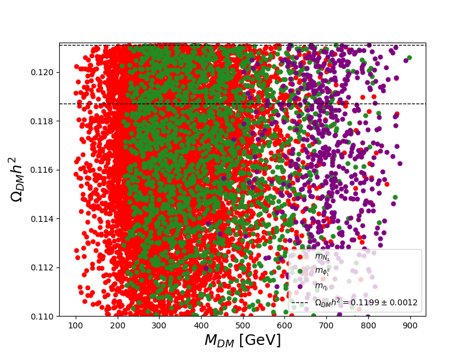

# Scotogenic model: neutrinos and dark matter

[Español](README.md) · **English** · [Summary on the portfolio](https://johangb.github.io/en/#investigacion)

Undergraduate Physics thesis (Universidad de los Andes). It studies the dark matter
phenomenology of the scotogenic model, which explains neutrino masses at one loop and
provides dark matter candidates kept stable by a Z₂ symmetry.

## Questions

- What is the relic density in the freeze-out scenario?
- How does it correlate with the other model parameters?
- Which of the three dark matter candidates is viable, and which processes dominate its relic density?

## What was done

- An automated Python workflow connecting three scientific packages:
  **SARAH** (model and Feynman rules) → **SPheno** (mass spectrum) → **micrOMEGAs**
  (relic density and direct detection).
- Exploration of **13 model variables**, yielding **22,000 valid scenarios**.
- **Random-walk** and **MCMC** scans, compared with each other.
- The three candidates compared with the observed density,
  **Ωh² = 0.1199 ± 0.0012**, and with direct-detection limits from **LZ** and
  lepton-flavor-violation limits from **MEG** (μ → eγ) and μ → 3e.

## Layout

| Folder | Contents |
| --- | --- |
| `Tools/SARAH` | Model definition (`ScotoMod.m`, particles, parameters) |
| `Tools/SPheno` | SPheno configuration and version used |
| `Tools/micrOMEGAs` | micrOMEGAs outputs and cross-section scripts |
| `Tools/FeynRules`, `Tools/MadGraph` | UFO model for process generation |
| `Tools/Python` | Reading the `.root` chains, lists and comparison with LZ data |
| `Results/Images` | Scan plots (relic density, masses, couplings, LFV) |
| `Results/Scan's Files` | Scan chains in ROOT format |
| `run_sarah_Scotogenic.nb` | Mathematica notebook that runs SARAH |
| `Scotogenic-EWSB.pdf` | SARAH-generated document with the model equations |

## Limitations

- This is an academic research repository: it keeps the inputs and results of the work,
  not an installable package. Reproducing it requires Mathematica, SARAH, SPheno and micrOMEGAs.
- The full random-scan file is in the university's storage
  (see `Results/Scan's Files/README.md`).
