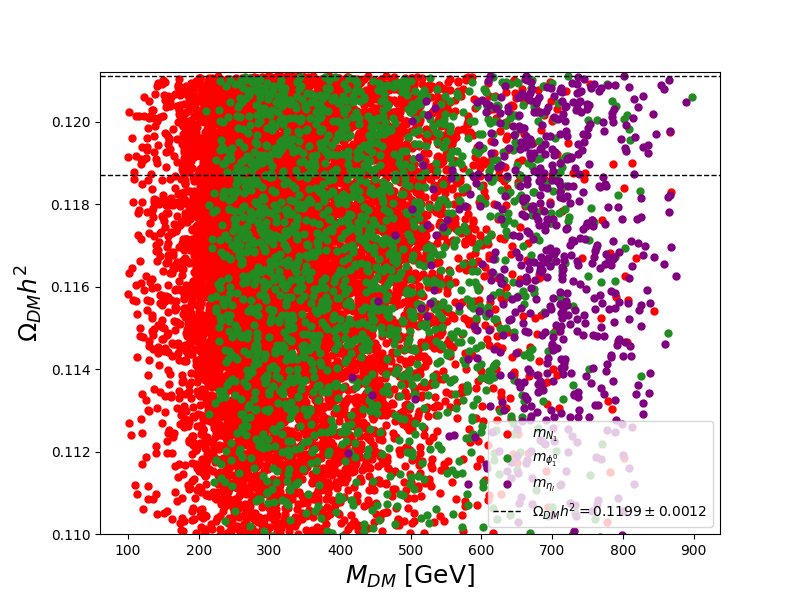

# Modelo escotogénico: neutrinos y materia oscura

**Español** · [English](README.en.md) · [Resumen en el portafolio](https://johangb.github.io/#investigacion)

Tesis de pregrado en Física (Universidad de los Andes). Estudia la fenomenología de materia
oscura del modelo escotogénico, que explica la masa de los neutrinos a un lazo y ofrece
candidatos a materia oscura estables por una simetría Z₂.

## Preguntas

- ¿Cuál es la densidad reliquia en el escenario de *freeze-out*?
- ¿Cómo se correlaciona con los demás parámetros del modelo?
- ¿Cuál de los tres candidatos a materia oscura es viable y qué procesos dominan su densidad reliquia?

## Qué se hizo

- Un flujo automatizado en Python que conecta tres programas científicos:
  **SARAH** (modelo y reglas de Feynman) → **SPheno** (espectro de masas) → **micrOMEGAs**
  (densidad reliquia y detección directa).
- Exploración de **13 variables** del modelo, con **22.000 escenarios válidos**.
- Barridos con **caminata aleatoria** y **MCMC**, comparados entre sí.
- Comparación de los tres candidatos con la densidad observada,
  **Ωh² = 0,1199 ± 0,0012**, y con los límites de detección directa del experimento **LZ**
  y de violación de sabor leptónico de **MEG** (μ → eγ) y μ → 3e.

## Estructura

| Carpeta | Contenido |
| --- | --- |
| `Tools/SARAH` | Definición del modelo (`ScotoMod.m`, partículas, parámetros) |
| `Tools/SPheno` | Configuración y versión de SPheno usada |
| `Tools/micrOMEGAs` | Salidas de micrOMEGAs y scripts de secciones eficaces |
| `Tools/FeynRules`, `Tools/MadGraph` | Modelo UFO para generar procesos |
| `Tools/Python` | Lectura de las cadenas `.root`, listas y comparación con datos de LZ |
| `Results/Images` | Gráficas de los barridos (densidad reliquia, masas, acoples, LFV) |
| `Results/Scan's Files` | Cadenas de los barridos en formato ROOT |
| `run_sarah_Scotogenic.nb` | Notebook de Mathematica que corre SARAH |
| `Scotogenic-EWSB.pdf` | Documento generado por SARAH con las ecuaciones del modelo |

## Limitaciones

- Es un repositorio de investigación académica: guarda los insumos y resultados del trabajo,
  no un paquete instalable. Reproducirlo exige instalar Mathematica, SARAH, SPheno y micrOMEGAs.
- El archivo del barrido aleatorio completo está en el almacenamiento de la universidad
  (ver `Results/Scan's Files/README.md`).
